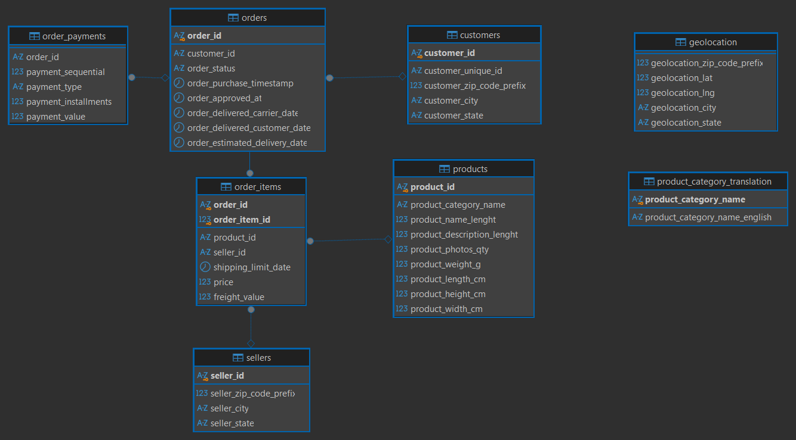

# Analisis Brazilian E-Commerce Dataset by Olist dengan PostgreSQL

Project ini latihan SQL memakai dataset e-commerce Olist dari Kaggle. Saya pakai PostgreSQL dan DBeaver. Isinya dari awal sampai akhir: membuat tabel, import data, cek kualitas data, lalu jawab pertanyaan bisnis pakai SQL.

## Dataset

- Sumber: [Brazilian E-Commerce Public Dataset by Olist](https://www.kaggle.com/datasets/olistbr/brazilian-ecommerce) di Kaggle
- 9 tabel yang saling berhubungan: orders, order items, payments, customers, sellers, products, geolocation, category translation, reviews
- Periode data: 4 September 2016 sampai 17 Oktober 2018
- Mata uang: real Brasil (BRL)

## Tools

PostgreSQL dan DBeaver.

Teknik SQL yang dipakai: JOIN beberapa tabel, CTE, window function (`LAG`, `RANK`, `SUM() OVER`), `COALESCE`, `FILTER`, `DATE_TRUNC`, `CASE WHEN`.

## Skema Database

Ada 8 tabel yang dimuat. Tabel `order_reviews` belum dimuat di versi ini.

Dua tabel sengaja tidak punya foreign key:
- `product_category_translation` adalah tabel acuan. Tabel ini digabung lewat nama kategori memakai `LEFT JOIN`, jadi produk yang tidak punya terjemahan tetap ikut terhitung.
- `geolocation` punya banyak baris untuk satu kode pos. Tidak ada kolom yang unik, jadi foreign key tidak bisa menunjuk ke tabel ini.

## File Proyek

Semua file SQL ada di folder `sql/`.

| File | Isi |
|------|-----|
| `sql/01_create_tables.sql` | Definisi tabel dan foreign key |
| `sql/02_data_quality_check.sql` | Jumlah baris, status order, tanggal kosong, cek logika tanggal |
| `sql/03_exploration.sql` | Rentang tanggal, order per bulan, gambaran revenue |
| `sql/04_revenue_bulanan.sql` | Revenue bulanan dan pertumbuhan bulan ke bulan |
| `sql/05_black_friday_check.sql` | Order harian di November 2017 |
| `sql/06_kategori_produk.sql` | Revenue per kategori produk |
| `sql/07_delivery_time.sql` | Waktu pengiriman dan order yang telat |
| `sql/08_seller.sql` | Sebaran seller dan peringkat revenue |

## Cek Kualitas Data dan Keputusan

Semua tabel berhasil dimuat dan jumlah barisnya sama dengan file sumber (contoh: 99.441 order dan 112.650 item order).

| Temuan | Keputusan |
|--------|-----------|
| 96.478 dari 99.441 order (97%) berstatus `delivered`. Sisanya shipped, canceled, unavailable, invoiced, processing, created, atau approved. | Revenue dan semua analisis utama hanya pakai order `delivered`. |
| 8 order `delivered` tidak punya tanggal sampai. | Dikeluarkan dari analisis waktu pengiriman. |
| Tidak ada order yang sampai sebelum tanggal pembelian (0 order). | Tidak perlu tindakan. |
| Foreign key dari `order_items` ke `orders`, `products`, dan `sellers` berhasil dipasang tanpa error. | Tidak ada baris yatim. Setiap item order menunjuk ke order, produk, dan seller yang ada. |
| Data 2016 sangat sedikit, dan September sampai Oktober 2018 hampir kosong (16 dan 4 order). November 2016 tidak ada barisnya. | Analisis tren pakai Januari 2017 sampai Agustus 2018 (20 bulan penuh). |

## Temuan Utama

### 1. Revenue naik cepat di 2017, lalu mendatar di 2018

Total revenue produk dari order `delivered` adalah 13,22 juta BRL, ditambah ongkir 2,20 juta BRL.

- Revenue bulanan naik dari sekitar 112 ribu BRL (Januari 2017) ke sekitar 988 ribu BRL (November 2017).
- Nilai rata-rata per order tidak banyak berubah. Jadi kenaikannya datang dari jumlah order, bukan dari keranjang yang lebih besar.
- Di 2018, revenue bertahan di kisaran 826 sampai 978 ribu BRL per bulan. Puncaknya di Mei (sekitar 978 ribu BRL), lalu turun setelah Juni. Agustus 2018 sekitar 14% di bawah puncak Mei.
- Persentase pertumbuhan di awal 2017 kelihatan besar (+109,5% di Februari) karena angka awalnya kecil.
- Februari 2018 turun 10,6%, tapi revenue per harinya hampir sama dengan Januari. Turunnya hampir seluruhnya karena Februari lebih pendek.

### 2. November 2017 adalah lonjakan di satu hari (black friday)

- Tanggal 24 November 2017 punya 1.176 order. Itu sekitar 15,6% dari seluruh order November, dan kira-kira 5 kali rata-rata hari lain di bulan itu.
- Tanggalnya sama dengan Black Friday 2017. Dataset tidak punya data promo, jadi penyebabnya baru dugaan yang kuat, belum terbukti.
- Desember turun 26,5% dari November, tapi masih di atas Oktober. Artinya level dasar penjualan juga ikut naik.

### 3. Revenue tersebar di banyak kategori

- Sepuluh kategori teratas memegang 62,4% revenue. Kategori terbesar, `health_beauty`, hanya 9,3%.
- `watches_gifts` ada di peringkat 2 untuk revenue, padahal ordernya lebih sedikit dari `bed_bath_table` (5.495 lawan 9.272). Revenue per order kira-kira 212 BRL lawan 110 BRL.
- Jadi urutan revenue dipengaruhi nilai per order, tidak cuma jumlah order.

### 4. Estimasi pengiriman longgar, dan kecepatan kirim beda antar wilayah

- Rata-rata pengiriman 12,5 hari, sedangkan rata-rata estimasinya 24,4 hari.
- Ada 6.534 order (6,8%) yang sampai setelah tanggal estimasi. Angka ini kecil sebagian karena estimasinya panjang.
- Waktu kirim sangat beda per negara bagian customer: 8,7 hari di SP, 29,3 hari di RR.
- Dari 17 negara bagian paling lambat (17,6 hari ke atas), 16 ada di wilayah Utara dan Timur Laut. Negara bagian kecil seperti RR (41 order) dan AP (67 order) rata-ratanya kurang stabil, tapi tetangganya menunjukkan arah yang sama.

### 5. Seller menumpuk di wilayah Selatan dan Tenggara

- 94,7% dari 3.095 seller ada di enam negara bagian (SP, PR, MG, SC, RJ, RS). SP sendiri 59,7%.
- SP sekitar 42% dari order customer, jadi SP juga mengirim ke wilayah lain.
- AL, AP, RR, dan TO tidak punya seller sama sekali. Sembilan dari 17 negara bagian paling lambat punya nol atau satu seller lokal. Ini sejalan dengan selisih waktu kirim, tapi analisis ini belum membuktikan bahwa jarak penyebabnya.
- Revenue tidak bergantung pada satu seller. Seller teratas memegang 1,72% revenue, dan sepuluh seller teratas sekitar 13,3%.

## Notes

- Waktu pengiriman dihitung dari tanggal beli sampai tanggal sampai. Isinya gabungan waktu seller menyiapkan barang, perjalanan kurir, dan jarak, jadi jarak tidak bisa dipisahkan sendiri.
- Tabel `order_reviews` belum dianalisis, jadi belum ada analisis skor review.
- Tabel `geolocation` sudah dimuat tapi belum dipakai.
- Total revenue per kategori belum dicocokkan ulang dengan total revenue keseluruhan.
- Penyebab lonjakan 24 November 2017 disimpulkan dari tanggalnya, bukan dari data promo.

